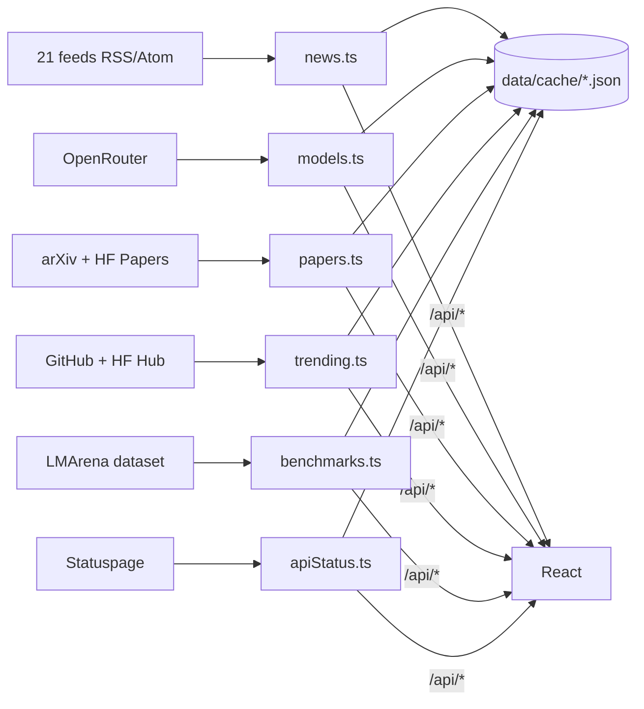

# Radar IA

Painel pessoal sobre inteligência artificial, coletado de fontes públicas a cada 5 minutos:

- **Notícias** de 21 fontes (laboratórios, imprensa em inglês e português, Hacker News e Reddit), com tópicos, empresas e modelos atribuídos por regras: novos modelos, novas funções, novidades, cibersegurança, agentes, programação, imagem e vídeo, voz, open source, pesquisa, negócios, regulação, chips, robótica, saúde, educação, segurança da IA.
- **Modelos**: os 460+ modelos da OpenRouter com preço, contexto, capacidades e índices da Artificial Analysis; filtros, ordenação e comparação lado a lado.
- **Benchmarks**: 10 placares da LMArena (texto, programação web, agentes, visão, documentos, busca, imagem, edição, vídeo) e os índices da Artificial Analysis.
- **Qual IA usar**: 14 necessidades, cada uma com o ranking ao vivo e ferramentas para começar.
- **Artigos** (HF Daily Papers e arXiv), **Em alta** (GitHub e Hugging Face), **Linha do tempo** de lançamentos, **Salvos** e **Como funciona**.

Sem API paga e sem número digitado à mão (só as dicas do guia, em `data/guia.json`, são curadas). Base técnica: o Radar Eleitoral (`../Observacao`).

> Instruções para agentes de código, regras e histórico: [`AGENTS.md`](AGENTS.md). Fontes, endereços e o que ficou de fora: [`docs/fontes.md`](docs/fontes.md).

## Como funciona



- `server/scheduler.ts` dispara cada coletor no seu ritmo (5, 10, 30 ou 60 min), escalonados 4 s entre si.
- `server/lib/collector.ts`: cache com promessa compartilhada; `?refresh=1` força no máximo a cada 15 s; resposta parcial é refeita em 1 a 5 min.
- `server/lib/feed.ts`: leitor de RSS e Atom, extraído do `live.ts` do Radar Eleitoral.
- `server/classify.ts`: regras de tópico, empresa e modelo (palavra inteira, prefixo `pref*` ou frase), em inglês e português.
- Histórico em `data/cache/` (fora do git): notícias de 7 dias e a última resposta boa de cada fonte, para a tela não ficar vazia se uma fonte cair.

| Rota | Conteúdo |
|---|---|
| `GET /api/overview` | resumo da página inicial |
| `GET /api/news` | notícias de 7 dias (~1 MB, enviado com gzip) |
| `GET /api/models`, `/api/papers`, `/api/trending`, `/api/benchmarks`, `/api/api-status` | cada seção |
| `GET /api/guide` | `data/guia.json` |
| `GET /api/health`, `GET /api/status` | abertas, sem senha; o status só tem contagens e saúde das fontes |

## Rodar no computador

```bash
pnpm install
```

```bash
pnpm dev
```

Abre em http://127.0.0.1:3000. Para a versão de produção, `iniciar.cmd`. Testes: `pnpm test`; tipos: `pnpm check`.

## Publicar no Render

`render.yaml` cria o serviço gratuito atrás de senha (`APP_PASSWORD`, digitada no painel). O plano gratuito dorme após 15 minutos sem visita e apaga `data/cache` a cada deploy: ao acordar, a primeira coleta leva cerca de um minuto e o histórico de notícias recomeça.

## Próximos passos sugeridos

- Alerta no navegador quando surgir modelo novo de uma empresa marcada.
- "Resumo do dia" agrupando a mesma história entre fontes.
- Calendário de eventos e conferências; glossário de IA em português.
- Coletor no GitHub Actions gravando o histórico numa branch `dados`, para o Render não perder nada.
