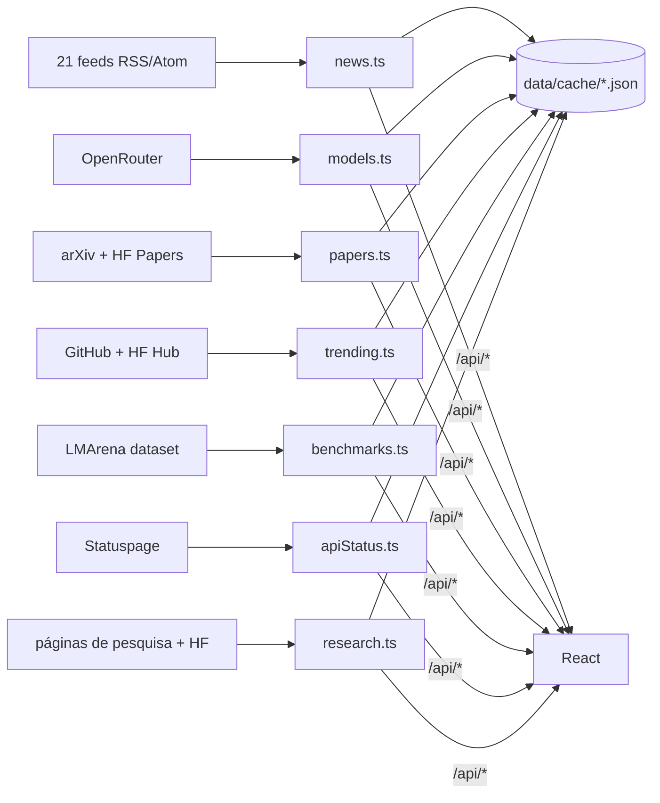

# Radar IA

Painel pessoal sobre inteligência artificial. Reúne notícias, modelos, preços, benchmarks, pesquisa e artigos de fontes públicas, atualizados a cada 5 minutos, e organiza tudo para responder a uma pergunta simples: **o que mudou em IA hoje, e qual ferramenta vale a pena usar?**


---

## Sumário

- [O que tem no painel](#o-que-tem-no-painel)
- [Telas](#telas)
- [Fontes de dados](#fontes-de-dados)
- [Como funciona](#como-funciona)
- [Princípios do projeto](#princípios-do-projeto)
- [Stack](#stack)
- [Estrutura do repositório](#estrutura-do-repositório)
- [Rodar no computador](#rodar-no-computador)
- [Variáveis de ambiente](#variáveis-de-ambiente)
- [API HTTP](#api-http)
- [Testes e qualidade](#testes-e-qualidade)
- [Publicar no Render](#publicar-no-render)
- [Limitações conhecidas](#limitações-conhecidas)
- [Contribuir](#contribuir)
- [Créditos](#créditos)
- [Licença](#licença)

---

## O que tem no painel

- **Notícias classificadas.** 21 fontes (laboratórios de IA, imprensa em inglês e português, Hacker News e Reddit). Cada notícia recebe tópicos, empresas e modelos atribuídos por regras, sem IA paga: novos modelos, novas funções, novidades, cibersegurança, agentes, programação, imagem e vídeo, voz, open source, pesquisa, negócios, regulação, chips, robótica, saúde, educação e segurança da IA.
- **Modelos e preços.** Os modelos listados pela OpenRouter, com preço por milhão de tokens, janela de contexto, modalidades e índices de inteligência da Artificial Analysis. Há filtros, ordenação e comparação lado a lado.
- **Benchmarks.** Dez placares da LMArena (texto, programação web, agentes, visão, documentos, busca, imagem, edição e vídeo) e os índices da Artificial Analysis.
- **Qual IA usar.** Catorze necessidades comuns (escrever, programar, pesquisar, imagem, voz e outras), cada uma com o ranking ao vivo e ferramentas para começar.
- **Pesquisa por provedor.** Uma área para cada um dos doze provedores acompanhados (Anthropic, OpenAI, Google, Moonshot AI, DeepSeek, Manus, Meta AI, ElevenLabs, Qwen, GLM, Copilot e Grok), com posts das páginas de pesquisa e blogs oficiais, artigos que o laboratório assina no Hugging Face Papers e modelos de pesos abertos publicados.
- **Artigos.** Os destaques diários do HF Daily Papers e os artigos mais recentes de cs.AI, cs.CL, cs.LG e cs.CV no arXiv.
- **Em alta.** Repositórios de IA mais populares do GitHub criados nos últimos 30 dias, e modelos e espaços em tendência no Hugging Face.
- **Linha do tempo.** Lançamentos de modelos em ordem cronológica.
- **Salvos.** Marcadores guardados no próprio navegador.
- **Como funciona.** Explica de onde vem cada número e o que é curado à mão.

## Telas

| Caminho | Tela |
|---|---|
| `/` | Página inicial com o resumo de todas as seções |
| `/noticias` | Notícias dos últimos 7 dias, com filtros por tópico, empresa e modelo |
| `/modelos` | Catálogo de modelos com preço, contexto e índices |
| `/benchmarks` | Placares da LMArena e índices da Artificial Analysis |
| `/guia` | "Qual IA usar", com ranking ao vivo por necessidade |
| `/pesquisa` e `/pesquisa/:provedor` | Área de pesquisa geral e por provedor |
| `/artigos` | Artigos do HF Daily Papers e do arXiv |
| `/em-alta` | Repositórios e modelos em tendência |
| `/linha-do-tempo` | Lançamentos em ordem cronológica |
| `/salvos` | Itens marcados pelo usuário |
| `/como-funciona` | Metodologia e fontes |

## Fontes de dados

Todas as fontes são públicas e gratuitas, e nenhuma exige chave de API. O `GITHUB_TOKEN` é opcional e serve só para aumentar o limite de consultas ao GitHub.

| Seção | Fonte | Ritmo de coleta |
|---|---|---|
| Notícias | Feeds RSS e Atom de laboratórios, imprensa e comunidade | 5 min |
| Modelos e preços | OpenRouter (`/api/v1/models`) | 5 min |
| Status das APIs | Statuspage de OpenAI, Anthropic, GitHub, Cohere e Perplexity | 5 min |
| Artigos | arXiv e HF Daily Papers | 10 min (arXiv no máximo a cada 30 min) |
| Pesquisa | Páginas de pesquisa, blogs, Hugging Face Papers e Hugging Face Hub | 30 min |
| Em alta | GitHub Search e Hugging Face Hub | 30 min |
| Benchmarks | Dataset `lmarena-ai/leaderboard-dataset` (CC BY 4.0) | 1 h |

A lista completa, com endereços, observações e as fontes que ficaram de fora e por quê, está em [`docs/fontes.md`](docs/fontes.md).

## Como funciona



1. **Agendador.** `server/scheduler.ts` dispara cada coletor no seu próprio ritmo. Os coletores começam com 4 segundos de diferença entre si, para que uma reinicialização não dispare todas as fontes de uma vez.
2. **Cache compartilhado.** `server/lib/collector.ts` guarda a última resposta boa de cada coletor. Várias requisições simultâneas esperam a mesma coleta, e `?refresh=1` força uma nova coleta, no máximo a cada 15 segundos. Se uma fonte falhar, a tela mostra a última resposta válida em vez de ficar vazia.
3. **Leitura.** `server/lib/feed.ts` lê RSS e Atom. `server/lib/cards.ts` lê páginas de listagem que não têm feed, como a de pesquisa da Anthropic, o blog da xAI e o da Manus.
4. **Classificação.** `server/classify.ts` aplica regras de tópico, empresa e modelo em inglês e português. Cada regra pode ser uma palavra inteira (`"palavra"`), um prefixo (`"prefixo*"`) ou uma frase (`"duas palavras"`). Há testes para os falsos amigos do português, como "aí" virando "ai" ou "meta" e "mercado" com sentido comum.
5. **Histórico.** Notícias dos últimos 7 dias ficam em `data/cache/`, fora do git.
6. **Interface.** O React consome as rotas `/api/*` com React Query, atualizando a cada 5 minutos.

## Princípios do projeto

- **Sem API paga.** Coleta e classificação usam só regras e APIs públicas gratuitas.
- **Nenhum dado inventado.** Todo número vem de uma fonte e mostra de onde veio. A única parte escrita à mão é o guia de ferramentas em [`data/guia.json`](data/guia.json), que traz a data da última revisão (`reviewedAt`). Os rankings do guia vêm dos dados ao vivo.
- **Português na interface.** Textos da interface em pt-BR. Manchetes e resumos em inglês continuam no original.
- **Cada fonte é conferida.** Antes de entrar na lista, o endereço é testado, uma fixture real e enxuta é salva em `server/fixtures/` e a fonte é documentada. Fonte que falha de forma persistente sai da lista e passa a constar na seção "Fora da lista" de `docs/fontes.md`.

## Stack

- **Front-end:** React 19, Vite 7, Wouter (roteamento), TanStack React Query 5, Lucide e Inter (fonte).
- **Back-end:** Express 4 em Node.js 22, com TypeScript em todo o projeto.
- **Testes e build:** Vitest, esbuild, Prettier e `tsc --noEmit`.
- **Gerenciador de pacotes:** pnpm 10.18.0.

## Estrutura do repositório

```
client/            Interface React (páginas, componentes, bibliotecas)
server/
  _core/           Servidor Express, gate de senha, servir arquivos estáticos
  collectors/      Um arquivo por fonte de dados (notícias, modelos, artigos...)
  lib/             Leitor de feeds, leitor de cards, cache, cliente HTTP
  classify.ts      Regras de classificação de notícias
  scheduler.ts     Agendamento das coletas
  fixtures/        Respostas reais das fontes, cortadas para poucos itens
shared/            Tipos compartilhados entre servidor e interface
data/guia.json     Guia "Qual IA usar" (curado à mão, com data de revisão)
docs/fontes.md     Lista de fontes, endereços e fontes descartadas
render.yaml        Configuração para deploy no Render (plano gratuito)
iniciar.cmd        Atalho para subir a versão de produção no Windows
```

## Rodar no computador

**Pré-requisitos:** Node.js 22 e pnpm 10.18.0 (ou a versão indicada em `packageManager`). Com o Corepack habilitado, o pnpm é ativado automaticamente.

```bash
pnpm install
pnpm dev
```

Abra http://127.0.0.1:3000. O servidor escuta apenas em `127.0.0.1`, então não fica acessível na rede local.

Outros comandos:

```bash
pnpm test     # testes com Vitest
pnpm check    # verificação de tipos com tsc --noEmit
pnpm build    # gera o front-end (dist/) e o servidor (dist/index.js)
pnpm start    # roda a versão de produção
```

No Windows, `iniciar.cmd` gera o build na primeira execução, abre o navegador e sobe a versão de produção em http://127.0.0.1:3000.

## Variáveis de ambiente

Nenhuma variável é obrigatória para uso local. Para copiar os valores, use `.env.example` como modelo e crie um arquivo `.env`, que nunca é versionado.

| Variável | Padrão | Para que serve |
|---|---|---|
| `APP_PASSWORD` | (vazio) | Senha do acesso HTTP Basic. Sem ela, o app fica aberto, o que é o esperado em uso local |
| `APP_USER` | `radar` | Usuário do acesso HTTP Basic |
| `GITHUB_TOKEN` | (vazio) | Token do GitHub sem escopos, para a busca de repositórios em alta |
| `DATA_DIR` | `data/cache` | Pasta onde o histórico é gravado |
| `DISABLE_SCHEDULER` | (vazio) | Com `1`, desliga a coleta em segundo plano |
| `PORT` | `3000` | Porta do servidor |
| `HOST` | `127.0.0.1` | Endereço de escuta. Use `0.0.0.0` apenas em hospedagem |
| `TRUST_PROXY` | (vazio) | Com `1`, confia no `X-Forwarded-For` (necessário atrás de proxy, como o Render) |

## API HTTP

| Rota | Conteúdo |
|---|---|
| `GET /api/overview` | Resumo da página inicial |
| `GET /api/news` | Notícias dos últimos 7 dias (gzip) |
| `GET /api/models` | Catálogo de modelos e preços |
| `GET /api/papers` | Artigos |
| `GET /api/trending` | Em alta |
| `GET /api/benchmarks` | Placares e índices |
| `GET /api/api-status` | Status das APIs |
| `GET /api/research` | Área de pesquisa |
| `GET /api/guide` | Conteúdo de `data/guia.json` |
| `GET /api/health` | Verificação de saúde (aberta, sem senha) |
| `GET /api/status` | Contagens e saúde das fontes (aberta, sem senha) |

As rotas de dados aceitam `?refresh=1` para forçar uma nova coleta, respeitando o intervalo mínimo de 15 segundos.

## Testes e qualidade

```bash
pnpm test
```

A suíte usa Vitest e cobre o gate de senha, a classificação de notícias, os coletores e o leitor de pesquisa. Os testes de parser usam fixtures reais de `server/fixtures/`. Ao mudar um parser ou uma regra de classificação, acrescente um teste com uma fixture real, cortada para poucos itens.

## Publicar no Render

O arquivo `render.yaml` descreve um serviço web gratuito:

- Build: `pnpm install --frozen-lockfile` seguido de `pnpm build`.
- Início: `node dist/index.js`.
- Verificação de saúde: `/api/health`.
- Senha (`APP_PASSWORD`) e token (`GITHUB_TOKEN`) são digitados no painel do Render e nunca vão para o repositório.

No plano gratuito, o serviço dorme após cerca de 15 minutos sem visitas e o disco é apagado a cada deploy. Ao acordar, a primeira coleta leva cerca de um minuto, e o histórico de notícias recomeça.

## Limitações conhecidas

- **Histórico efêmero na nuvem.** No Render gratuito, o `data/cache` some a cada deploy e a cada suspensão do serviço.
- **Dependência de fontes externas.** Algumas fontes respondem 403, 404, 410 ou 429 ou ficam paradas. Elas são listadas em [`docs/fontes.md`](docs/fontes.md), e o painel mostra a saúde de cada uma.
- **Classificação por regras.** Sem IA paga, a classificação é heurística. Ela erra em casos ambíguos, e as regras são revisadas conforme os erros aparecem.
- **Benchmarks com atraso.** O dataset da LMArena é atualizado pelos responsáveis, não em tempo real.

## Contribuir

Contribuições são bem-vindas. Antes de abrir um pull request:

1. Leia [`AGENTS.md`](AGENTS.md), que traz as regras do projeto e o histórico de decisões.
2. Para uma fonte nova, confira o endereço com `curl`, salve uma fixture enxuta em `server/fixtures/` e documente a fonte em `docs/fontes.md`.
3. Rode `pnpm test` e `pnpm check`. Os dois precisam passar.
4. Mantenha a formatação do `.prettierrc` (largura 80, aspas duplas).

## Créditos

- **OpenRouter** pelo catálogo de modelos e preços, sem chave.
- **Artificial Analysis** pelos índices de inteligência, programação e agentes, acessados pela OpenRouter.
- **LMArena** pelo dataset de placares, licenciado como CC BY 4.0.
- **Hugging Face** pelo Hub, Spaces, Daily Papers e a API de artigos.
- **arXiv** pela API de artigos.
- Os laboratórios e veículos citados, cujos textos e títulos aparecem com a atribuição de origem em cada item.
- Este projeto foi derivado do Radar Eleitoral, com o mesmo modelo de coleta e cache.

## Licença

Distribuído sob a licença MIT, conforme indicado no campo `license` do `package.json`.

## Próximos passos

- Alerta no navegador quando surgir um modelo novo de uma empresa marcada.
- "Resumo do dia" que agrupe a mesma história publicada por fontes diferentes.
- Calendário de eventos e conferências, e um glossário de IA em português.
- Coletor no GitHub Actions gravando o histórico em uma branch `dados`, para que o Render não perca nada.
